# Лабораторная работа 4. Файлы: TXT/CSV и отчёты по текстовой статистике

## Содержание

1. [Как запустить](#как-запустить)
2. [Задание A. Модуль io_txt_csv.py](#задание-a-модуль-io_txt_csvpy)
3. [Задание B. Скрипт text_report.py](#задание-b-скрипт-text_reportpy)
4. [Задание ★. Несколько файлов и таблица](#задание--несколько-файлов-и-таблица)
5. [Кодировки](#кодировки)
6. [Краевые случаи и принятые решения](#краевые-случаи-и-принятые-решения)
7. [Тест-кейсы](#тест-кейсы)

## Как запустить

Все команды выполняются из корня репозитория (`python_labs`) в терминале с активным виртуальным окружением. Нужен Python 3.9 или новее.

```powershell
# базовый запуск: читает data/lab04/input.txt, пишет data/lab04/report.csv
python src/lab04/text_report.py

# свои пути и кодировка
python src/lab04/text_report.py --in data/lab04/input.txt --out data/lab04/out.csv --encoding utf-8

# несколько файлов (★)
python src/lab04/text_report.py --in data/lab04/a.txt data/lab04/b.txt --per-file data/lab04/report_per_file.csv --total data/lab04/report_total.csv
```

| Параметр | Значение по умолчанию | Назначение |
|---|---|---|
| `--in` | `data/lab04/input.txt` | один или несколько входных файлов |
| `--out` | `data/lab04/report.csv` | базовый отчёт `word,count` |
| `--encoding` | `utf-8` | кодировка входных файлов |
| `--per-file` | не создаётся | ★ отчёт `file,word,count` по каждому файлу |
| `--total` | не создаётся | ★ сводный отчёт `word,count` по всем файлам |

> [!NOTE]
> CSV-файлы сохраняются в UTF-8. При просмотре в Windows PowerShell используйте `Get-Content файл.csv -Encoding UTF8`, иначе русские буквы отобразятся некорректно.

## Задание A. Модуль io_txt_csv.py

| Функция | Что делает |
|---|---|
| `read_text(path, encoding="utf-8")` | читает файл целиком и возвращает строку; `FileNotFoundError` и `UnicodeDecodeError` не перехватываются и всплывают к вызывающему коду |
| `write_csv(rows, path, header=None)` | создаёт или перезаписывает CSV с разделителем `,`; пишет заголовок, если он передан; проверяет, что все строки одной длины, иначе `ValueError` |
| `ensure_parent_dir(path)` | создаёт недостающие родительские папки (`mkdir(parents=True, exist_ok=True)`) |

<details>
<summary>Код src/lab04/io_txt_csv.py</summary>

```python
from __future__ import annotations

import csv
from collections.abc import Iterable
from pathlib import Path


def ensure_parent_dir(path: str | Path) -> None:
    """Создаёт родительские директории для path, если их ещё нет.

    Args:
        path: путь к файлу, для которого нужна папка.
    """
    Path(path).parent.mkdir(parents=True, exist_ok=True)


def read_text(path: str | Path, encoding: str = "utf-8") -> str:
    """Читает файл целиком и возвращает содержимое как одну строку.

    FileNotFoundError (файла нет) и UnicodeDecodeError (не та кодировка)
    не перехватываются: они всплывают к вызывающему коду.
    Другую кодировку можно выбрать параметром, например:
        read_text("data/input.txt", encoding="cp1251")

    Args:
        path: путь к файлу.
        encoding: кодировка файла, по умолчанию utf-8.

    Returns:
        Содержимое файла. Для пустого файла возвращается пустая строка.
    """
    return Path(path).read_text(encoding=encoding)


def write_csv(
    rows: Iterable[tuple | list],
    path: str | Path,
    header: tuple[str, ...] | None = None,
) -> None:
    """Создаёт или перезаписывает CSV-файл с разделителем ','.

    Если задан header, он записывается первой строкой. Все строки
    (и header, если он есть) должны быть одинаковой длины, иначе ValueError.
    Пустой rows без header даёт пустой файл, с header даёт файл
    только с заголовком.

    Args:
        rows: строки таблицы (кортежи или списки).
        path: путь к CSV-файлу; недостающие папки создаются.
        header: необязательный заголовок таблицы.

    Raises:
        ValueError: если длины строк различаются.
    """
    rows = list(rows)
    lengths = {len(row) for row in rows}
    if header is not None:
        lengths.add(len(header))
    if len(lengths) > 1:
        raise ValueError("Строки CSV имеют разную длину")

    ensure_parent_dir(path)
    with Path(path).open("w", newline="", encoding="utf-8") as f:
        writer = csv.writer(f)
        if header is not None:
            writer.writerow(header)
        writer.writerows(rows)
```

</details>

### Мини-тесты модуля

```powershell
python -c "import sys; sys.path.insert(0,'src/lab04'); from io_txt_csv import *; print(repr(read_text('data/lab04/input.txt'))); write_csv([('word','count'),('test',3)], 'data/lab04/check.csv')"
```
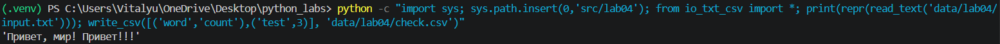

Проверка `ValueError` при строках разной длины:

```powershell
python -c "import sys; sys.path.insert(0,'src/lab04'); from io_txt_csv import write_csv; write_csv([(1,2),(3,)], 'data/lab04/x.csv')"
```
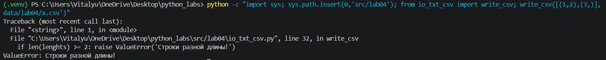

## Задание B. Скрипт text_report.py

Скрипт выполняет следующие шаги:

1. Читает входной файл (`read_text`).
2. Нормализует текст и разбивает на слова (`normalize`, `tokenize` из ЛР3).
3. Считает частоты (`count_freq`) и сортирует пары: `count` по убыванию, затем слово по возрастанию.
4. Сохраняет отчёт `word,count` в CSV (`write_csv`).
5. Печатает в консоль общее число слов, число уникальных слов и топ-5 (`top_n` из ЛР3).

Пример `report.csv` для текста `Привет, мир! Привет!!!`:

```csv
word,count
привет,2
мир,1
```

## Задание ★. Несколько файлов и таблица

- `--in` принимает несколько файлов. Частоты считаются по каждому файлу отдельно и сохраняются в `--per-file` (`file,word,count`, сортировка: файл по возрастанию, `count` по убыванию, слово по возрастанию).
- Сводный отчёт по всем файлам вместе сохраняется в `--total` (`word,count`).
- Параллельно с CSV в консоль печатается таблица, ширина столбцов подбирается по самому длинному значению.

<details>
<summary>Код src/lab04/text_report.py</summary>

```python
from __future__ import annotations

import argparse
import sys
from collections.abc import Sequence
from pathlib import Path

# чтобы работали импорты "from lib.text import ..." при запуске из корня репозитория
sys.path.insert(0, str(Path(__file__).resolve().parents[1]))

from lib.text import normalize, tokenize, count_freq, top_n  # из ЛР3
from io_txt_csv import read_text, write_csv


def sorted_word_counts(freq: dict[str, int]) -> list[tuple[str, int]]:
    """Возвращает все пары (слово, число) в нужном порядке.

    Порядок: count по убыванию, при равенстве слово по возрастанию.

    Args:
        freq: словарь {слово: частота}.
    """
    return sorted(freq.items(), key=lambda kv: (-kv[1], kv[0]))


def load_tokens(path: str | Path, encoding: str = "utf-8") -> list[str]:
    """Читает файл и превращает его текст в список слов.

    Ошибки чтения (FileNotFoundError, UnicodeDecodeError) не перехватываются.

    Args:
        path: путь к текстовому файлу.
        encoding: кодировка файла.

    Returns:
        Список слов после нормализации и токенизации.
    """
    return tokenize(normalize(read_text(path, encoding=encoding)))


def print_table(
    rows: Sequence[tuple[str, int]],
    header: tuple[str, str] = ("word", "count"),
) -> None:
    """Печатает таблицу в консоль, ширина столбцов по самому длинному значению (★).

    Args:
        rows: пары (слово, число).
        header: заголовки двух столбцов.
    """
    data = [header] + [(word, str(count)) for word, count in rows]
    width_word = max(len(row[0]) for row in data)
    width_count = max(len(row[1]) for row in data)
    for i, (word, count) in enumerate(data):
        print(f"{word:<{width_word}} | {count:<{width_count}}")
        if i == 0:
            print("-" * width_word + "-+-" + "-" * width_count)


def parse_args() -> argparse.Namespace:
    """Разбирает параметры командной строки."""
    parser = argparse.ArgumentParser(description="Отчёт по частотам слов в текстовых файлах")
    parser.add_argument("--in", dest="inputs", nargs="+", default=["data/lab04/input.txt"],
                        help="один или несколько входных файлов")
    parser.add_argument("--out", default="data/lab04/report.csv",
                        help="выходной CSV word,count")
    parser.add_argument("--encoding", default="utf-8",
                        help="кодировка входных файлов (например cp1251)")
    parser.add_argument("--per-file", default=None,
                        help="★ CSV file,word,count по каждому файлу")
    parser.add_argument("--total", default=None,
                        help="★ сводный CSV word,count по всем файлам")
    return parser.parse_args()


def main() -> None:
    """Читает файлы, считает частоты, пишет CSV-отчёты и печатает резюме."""
    args = parse_args()

    all_tokens: list[str] = []
    per_file_rows: list[tuple[str, str, int]] = []

    for path in args.inputs:
        try:
            tokens = load_tokens(path, encoding=args.encoding)
        except FileNotFoundError:
            print(f"Ошибка: файл не найден: {path}")
            sys.exit(1)
        except UnicodeDecodeError:
            print(f"Ошибка: не удалось прочитать {path} в кодировке {args.encoding}. "
                  f"Попробуйте указать другую, например --encoding cp1251")
            sys.exit(1)

        all_tokens.extend(tokens)

        freq_file = count_freq(tokens)
        name = Path(path).name
        for word, count in sorted_word_counts(freq_file):
            per_file_rows.append((name, word, count))

    freq = count_freq(all_tokens)
    rows = sorted_word_counts(freq)

    # базовый отчёт (при одном входном файле это отчёт по нему)
    write_csv(rows, args.out, header=("word", "count"))

    # ★ отчёт по каждому файлу: file ↑, count ↓, word ↑
    if args.per_file:
        per_file_rows.sort(key=lambda r: (r[0], -r[2], r[1]))
        write_csv(per_file_rows, args.per_file, header=("file", "word", "count"))

    # ★ сводный отчёт по всем файлам
    if args.total:
        write_csv(rows, args.total, header=("word", "count"))

    print(f"Всего слов: {len(all_tokens)}")
    print(f"Уникальных слов: {len(freq)}")
    print("Топ-5:")
    for word, count in top_n(freq, 5):
        print(f"{word}:{count}")

    print()
    print_table(rows)


if __name__ == "__main__":
    main()
```

</details>

## Кодировки

- По умолчанию файлы читаются и записываются в **UTF-8**; кодировка всегда указывается явно.
- Для входного файла в другой кодировке используйте параметр `--encoding`, например `--encoding cp1251`.
- Если кодировка не подходит, скрипт выводит сообщение об ошибке с подсказкой и завершается с кодом 1.
- Выходные CSV всегда сохраняются в UTF-8.

## Краевые случаи и принятые решения

| Ситуация | Поведение |
|---|---|
| Пустой входной файл | `report.csv` содержит **только заголовок** `word,count`; в консоли нули |
| Входной файл не найден | сообщение «Ошибка: файл не найден: …» и `sys.exit(1)` |
| Неподходящая кодировка | сообщение с подсказкой про `--encoding` и `sys.exit(1)` |
| Строки разной длины в `write_csv` | `ValueError` до создания файла |
| `write_csv` с пустым `rows` | без `header` создаётся пустой файл, с `header` файл только с заголовком |
| Нет папки для выходного файла | создаётся автоматически (`ensure_parent_dir`) |
| Очень большой файл | по условию читается целиком; в реальных задачах файл лучше читать построчно, чтобы не держать весь текст в памяти |

> [!IMPORTANT]
> В примере из условия для `report_per_file.csv` при равных счётчиках слова идут в порядке «привет, мир». Формальное правило сортировки (`file ↑`, `count ↓`, `word ↑`) даёт порядок «мир, привет». В работе реализовано формальное правило.

## Тест-кейсы

| № | Что проверяется | Вход | Ожидаемый результат |
|---|---|---|---|
| A | базовый случай | `Привет, мир! Привет!!!` | `привет,2`, `мир,1`; всего слов 3, уникальных 2 |
| B | пустой файл | пустой `empty.txt` | в CSV только `word,count`; нули в консоли |
| C | кодировка cp1251 | `Привет` в cp1251, `--encoding cp1251` | `привет,1` |
| D★ | несколько файлов | `a.txt`: `Привет мир`, `b.txt`: `Привет, привет!` | per-file и total отчёты |

### A. Один файл (базовый случай)

```powershell
python src/lab04/text_report.py
Get-Content data\lab04\report.csv -Encoding UTF8
```

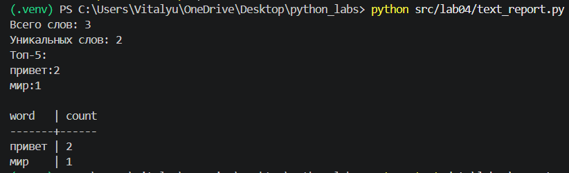

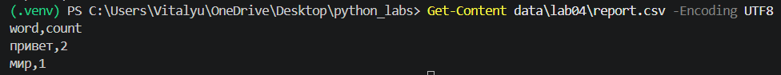
### B. Пустой файл

```powershell
python src/lab04/text_report.py --in data/lab04/empty.txt
Get-Content data\lab04\report.csv -Encoding UTF8
```
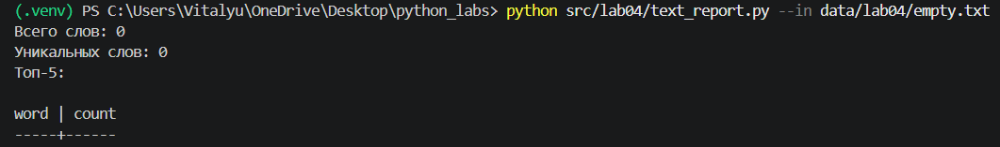

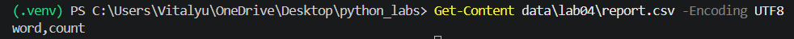

### C. Кодировка cp1251

```powershell
python src/lab04/text_report.py --in data/lab04/cp1251.txt --encoding cp1251
```

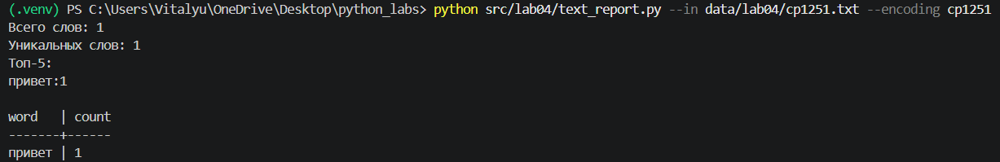

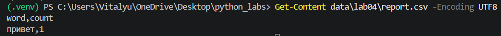

Тот же файл без `--encoding` (чтение в UTF-8 невозможно, выводится сообщение об ошибке):

```powershell
python src/lab04/text_report.py --in data/lab04/cp1251.txt
```

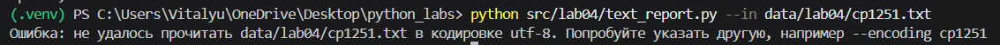

### D★. Несколько файлов

```powershell
python src/lab04/text_report.py --in data/lab04/a.txt data/lab04/b.txt --per-file data/lab04/report_per_file.csv --total data/lab04/report_total.csv
Get-Content data\lab04\report_per_file.csv -Encoding UTF8
Get-Content data\lab04\report_total.csv -Encoding UTF8
```

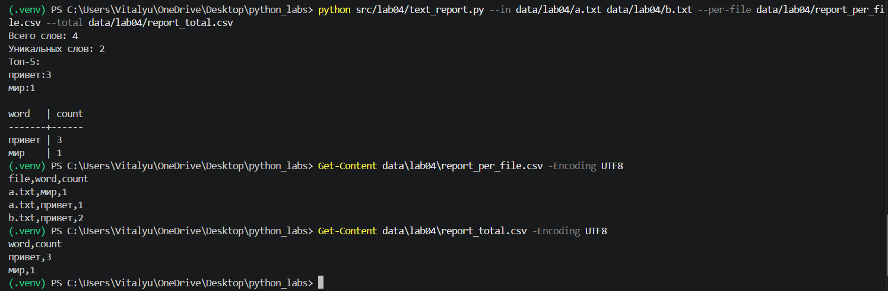

### Файл не найден

```powershell
python src/lab04/text_report.py --in data/lab04/net.txt
```

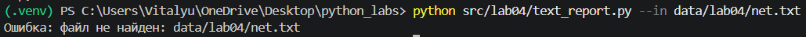

